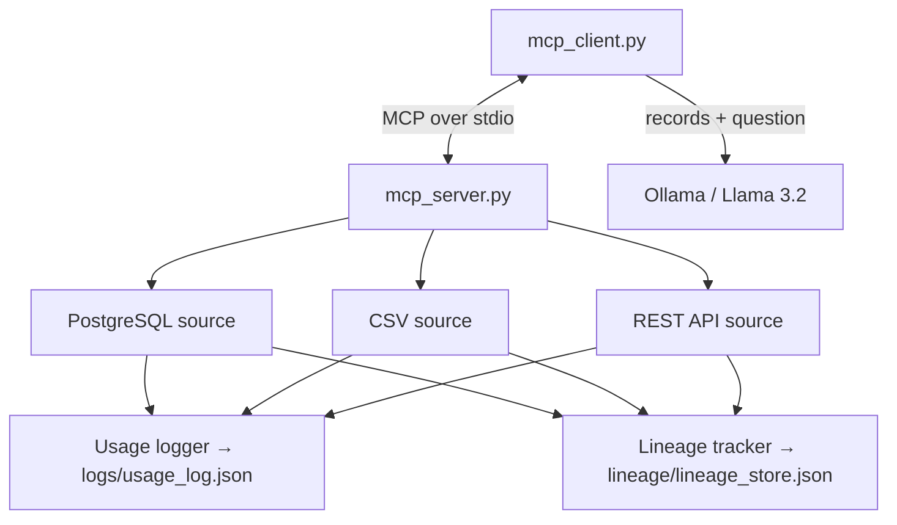

# MCP-Based Data Source Integration with Metadata & Lineage

An **MCP (Model Context Protocol) server** that exposes three different data sources — PostgreSQL, a CSV file and a live REST API — as tools an AI agent can discover and call. Every access is automatically recorded twice: a **usage log** (who, what, when, how many records) and a **lineage record** (origin, fields accessed, transformation, provenance). An MCP client calls the tools and passes the results to a local LLM to answer questions.

Runs fully locally with a free LLM (Llama 3.2 via Ollama).

## Tech stack

Python · MCP SDK (Anthropic, v1.27.2) · PostgreSQL · CSV · REST API · Ollama (Llama 3.2)

## Architecture



## MCP tools

| Tool | Source | Arguments |
|------|--------|-----------|
| `query_postgres` | PostgreSQL `employees` | `user`, `access_level` (optional) |
| `read_csv` | `data/sample_data.csv` | `user`, `department` (optional) |
| `fetch_api` | jsonplaceholder.typicode.com | `user`, `limit` (default 3) |
| `get_lineage_summary` | lineage store | `user` (optional) |
| `get_usage_logs` | usage log | `user`, `source` (optional) |

## Project structure

```
mcp_server.py              MCP server — declares and routes the 5 tools
mcp_client.py              MCP client — calls tools, asks the LLM, runs 5 demo tests
sources/postgres_source.py Source 1 — PostgreSQL
sources/csv_source.py      Source 2 — CSV
sources/api_source.py      Source 3 — public REST API
lineage/tracker.py         Lineage IDs, provenance, field-level tracking
logs/usage_logger.py       Usage event logging
data/sample_data.csv       Sample employees
db/setup.sql               Database and sample data
```

## Quick start

Prerequisites: Python 3.11+, PostgreSQL 15, [Ollama](https://ollama.com) with `ollama pull llama3.2`, internet (for the API source).

```bash
pip install -r requirements.txt
psql postgres -f db/setup.sql
python mcp_client.py          # starts the server automatically and runs all 5 tests
```

Run from the project root. Database settings are in `sources/postgres_source.py` (`get_connection`) — set the user to your PostgreSQL user.

## Example results

| Test | Tool | Question | AI answer |
|------|------|----------|-----------|
| 1 | `query_postgres` (admin) | Who are the admin employees? | Tejaswee Lashkare and Diana Prince — Engineering |
| 2 | `read_csv` (Analytics) | Average salary? | $73,500 |
| 3 | `fetch_api` (3 records) | Names and companies? | Leanne Graham / Romaguera-Crona, … |

## Skills demonstrated

MCP server and client design · data lineage and provenance · usage/audit logging · multi-source integration (SQL, files, HTTP) · async Python · LLM integration

## Author

Tejaswee Lashkare
